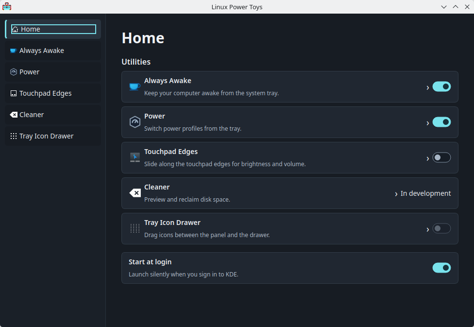
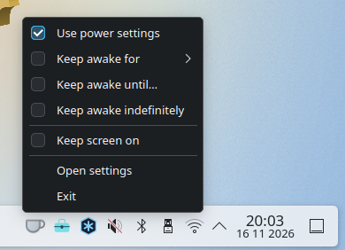
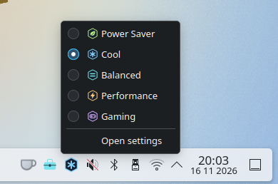
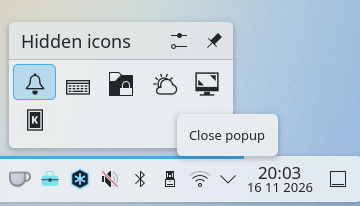
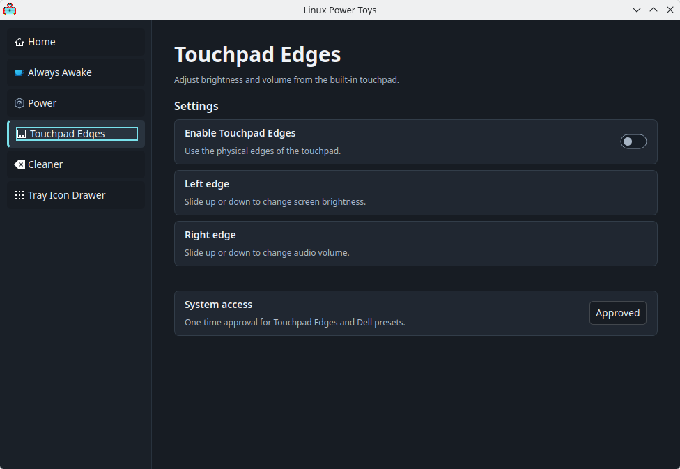

# Linux Power Toys

**A performance-first Linux desktop toolbox for KDE Plasma on Wayland.**

Keep your screen awake while you work, switch power profiles from the panel, and put your tray icons where you want them. Linux Power Toys brings those controls together in one Settings window and runs locally on your machine.

### [Download the Fedora preview](https://github.com/longweekendlabs/linux-power-toys/releases)

## Keep a task running

Use the coffee cup in the tray to keep your computer awake for a duration, until a specific time, or indefinitely. Choose separately whether the display stays on. Right-click the cup to change modes or exit Awake.

## Switch power profiles from the tray

Click the Power icon with either mouse button to open the profile menu. Choose from Fedora's available profiles, including Power Saver, Balanced, and Performance. Supported Dell systems also show Cool and Gaming after one-time administrator approval. The icon changes shape and color to show the confirmed active profile.

## Put tray icons in order

Drag icons from the Plasma panel into the overflow drawer, pull them back out, or reorder the icons already on your panel. Your placements carry over to the next login. Tray Icon Drawer uses a companion RPM matched to your Plasma version. After installing it, sign out and back in, then enable Tray Icon Drawer in Settings.

## Adjust brightness and volume from your touchpad

Slide one finger up or down along the left edge of a supported built-in touchpad to adjust screen brightness. Use the right edge for audio volume. Enable Touchpad Edges in Settings after the one-time administrator setup shared with the Dell power presets.

## Open the tools you use

Enable each tool separately from the Settings home page. The toolbox can start silently when you sign in to KDE and shows its tray icon while at least one tool is enabled. Cleaner is listed as in development.

## Download

Preview RPMs target Fedora KDE on Wayland (x86_64). Download the toolbox RPM and the optional, version-matched Drawer RPM from [GitHub Releases](https://github.com/longweekendlabs/linux-power-toys/releases) and the [changelog](CHANGELOG.md).

## Feedback

[Open an issue](https://github.com/longweekendlabs/linux-power-toys/issues) for a bug or a request.

## License

The original toolbox code is free and open source under the [MIT License](LICENSE). The [Awake artwork notice](assets/awake/NOTICE) credits Microsoft PowerToys. Tray Icon Drawer retains the upstream GPL and LGPL licenses of its Plasma components.

© 2026 Long Weekend Labs

Made with ♥ by Long Weekend Labs
